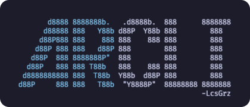

<!-- Header -->

<!-- Fin header -->

<!-- Mis redes -->

    
    &#8287;
    &#8287;
     

&#8287;
&#8287;

     
    &#8287;
    &#8287;
     
    &#8287;
    &#8287;
     

  
<!-- Fin mis redes -->

 
 

---

 
 

<!-- Mi presentacion -->

    

 

Desarrollador mobile con más de 8 años de experiencia creando aplicaciones cross-platform para iOS y Android. Trabajo con React Native y TypeScript, con foco en mobile architecture, performance optimization, plataformas multi-brand y AI-augmented engineering.

- Publiqué más de 40 releases para iOS y Android, con despliegues graduales en 16 clínicas del Reino Unido.
- Reduje el tiempo de carga de turnos de 3,35 s a casi cero mediante prefetching.
- Llevé una app a una arquitectura multi-brand en monorepo, habilitando 2 marcas desde una base compartida.
- Automaticé tareas de desarrollo con skills, subagentes e integraciones MCP, reduciendo cerca de un 45 % el trabajo repetitivo.
- Contribuí al desarrollo de productos para Mars Petcare, Dolby y Tenpo, en los sectores de salud, streaming y fintech.

<!-- Fin mi presentacion -->

 

<!-- Proyectos -->

## Proyectos

 
 

    
     
    
    &nbsp;
    
    &nbsp;
    
    &nbsp;
    

 

[CLI open source para ARCA](https://github.com/LcsGrz/arcli) que permite previsualizar y emitir comprobantes electrónicos desde la terminal. Incluye un asistente interactivo, comandos para automatizaciones y exportación a PDF.

<!-- Fin Proyectos -->

 
 

 <!-- Lenguajes - Herramientas -->

## Stack y herramientas

 
 
 

    <strong>Mobile y frontend</strong> 
    
    &nbsp;
    
    &nbsp;
    
    &nbsp;
    
    &nbsp;
    
    &nbsp;
    
    &nbsp;
    
    &nbsp;
    
    &nbsp;
    
    &nbsp;
    
       
    <strong>Estado y testing</strong> 
    
    &nbsp;
    
    &nbsp;
    
    &nbsp;
    
     
    Appium · Storybook
       
    <strong>Plataforma y entrega</strong> 
    
    &nbsp;
    
    &nbsp;
    
    &nbsp;
    
    &nbsp;
    
     
    CircleCI · Docker
     
    AppsFlyer deep links · Okta · GA4 · feature flags · monorepos
       
    <strong>IA aplicada al desarrollo</strong> 
    
    &nbsp;
    
    &nbsp;
    
    &nbsp;
    
     
    Custom agent skills · subagent workflows · MCP integrations

 
<!-- Fin lenguajes - Herramientas -->
 
 

 

---

 
 

<!-- Sumario -->

    

<!-- Fin sumario -->

 
 

---

 

<!-- Medallas -->

    
    &#8287;
    &#8287;
    
    &#8287;
    &#8287;
    

<!-- Fin medallas -->

 

---

 
 

<!-- Escrito -->

    

<!-- Fin escrito -->

<!-- Footer -->

<!-- Fin footer -->
